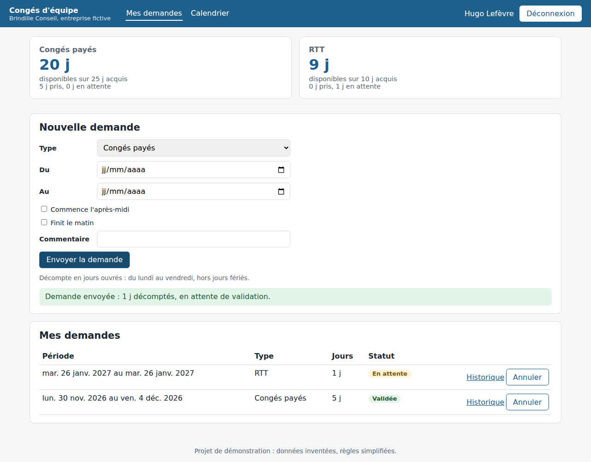
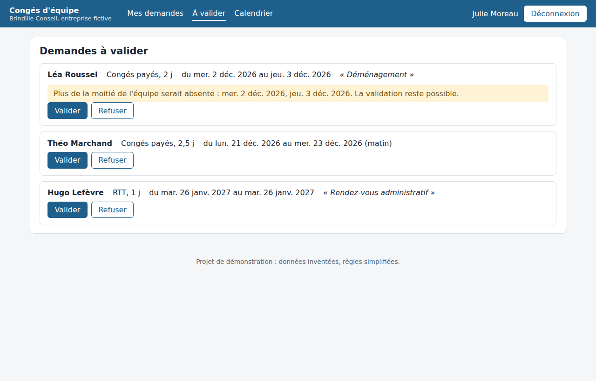
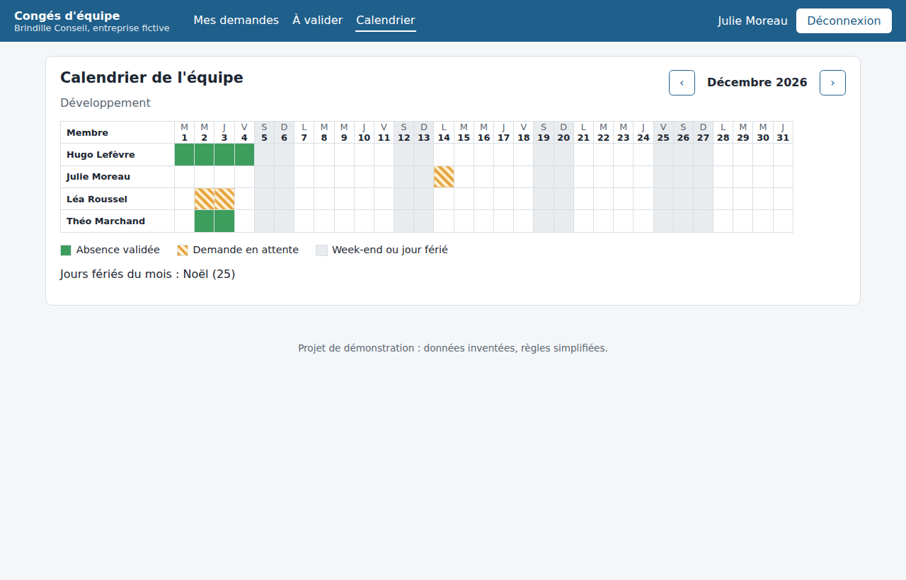

# conges-equipe

[](https://github.com/KorayAkyk/conges-equipe/actions/workflows/ci.yml)

Application web de gestion des congés d'une équipe pour une entreprise fictive, « Brindille Conseil » :
demandes de congés payés et de RTT, soldes, validation par le manager, historique et calendrier
d'équipe. Projet de démonstration : l'entreprise, les personnes et les données sont inventées.

Stack : Java 21, Spring Boot 3.5, Spring Security (JWT), Spring Data JPA, Flyway, PostgreSQL,
Angular 22, Playwright, Docker Compose.

*English summary at the end of this page.*

## Ce que fait le logiciel

- **Employé** : consulte ses soldes (acquis, pris, en attente, disponibles), dépose une demande avec
  demi-journées, l'annule tant qu'elle n'a pas commencé, consulte l'historique de chaque demande.
- **Manager** : voit les demandes en attente de son équipe, les valide ou les refuse avec un motif,
  consulte le calendrier de l'équipe.
- **RH** : mêmes droits sur toutes les équipes, y compris pour les demandes des managers.
- **API REST** documentée en OpenAPI, avec Swagger UI.

## Règles métier

Les règles sont **simplifiées** et documentées ici. Elles ne remplacent ni une convention collective,
ni un accord d'entreprise, ni un avis juridique.

| Règle | Comportement |
| --- | --- |
| Types | Congés payés et RTT, chacun avec son solde par personne. |
| Décompte | En jours ouvrés : du lundi au vendredi, hors jours fériés. Une demande peut commencer l'après-midi et finir le matin (une demi-journée de moins pour chacun, si le jour est ouvré). |
| Solde | Disponible = acquis - validé - en attente. Une demande qui dépasse le disponible est refusée. Le solde est recalculé à partir des demandes, aucun compteur n'est tenu à jour à la main. |
| Chevauchement | Refusé avec une autre demande en attente ou validée de la même personne. |
| Cycle | `EN_ATTENTE` puis `VALIDEE` ou `REFUSEE` (motif obligatoire). `ANNULEE` par l'employé, seulement avant le premier jour. Une demande déjà décidée ne se décide plus. |
| Droits | Un manager ne décide que pour son équipe et jamais pour sa propre demande. Les RH décident pour tous, sauf pour elles-mêmes. |
| Effectif | Avertissement, sans blocage, si plus de la moitié de l'équipe serait absente un même jour ouvré. |
| Historique | Chaque changement d'état est enregistré : ancien et nouveau statut, auteur, date, motif. |

### Jours fériés

Les onze fêtes légales de l'article L3133-1 du Code du travail sont calculées pour n'importe quelle
année : 1er janvier, lundi de Pâques, 1er mai, 8 mai, Ascension, lundi de Pentecôte, 14 juillet,
15 août, 1er novembre, 11 novembre, 25 décembre. Pâques est calculé avec l'algorithme de Meeus,
Jones et Butcher ; l'Ascension tombe 39 jours après, le lundi de Pentecôte 50 jours après.

Source : [service-public.gouv.fr, fiche F2405 « Jours fériés »](https://www.service-public.gouv.fr/particuliers/vosdroits/F2405)
(vérifiée le 1er janvier 2026), qui cite les articles L3133-1 à L3133-3 du Code du travail. Les tests
reprennent les listes 2026 et 2027 publiées sur cette fiche.

Simplifications assumées :

- tous les jours fériés sont traités comme chômés, alors que seul le 1er mai l'est obligatoirement ;
  les autres dépendent d'un accord ou de l'employeur (même fiche) ;
- le lundi de Pentecôte est traité comme férié, même s'il peut servir de journée de solidarité ;
- les deux jours propres à l'Alsace-Moselle (Vendredi saint, 26 décembre) ne sont pas gérés ;
- pas d'acquisition mensuelle des droits, de période de référence ni de report : les jours acquis
  sont une valeur fixe par personne et par type.

## Captures

Captures réelles prises par la CI, pendant le parcours Playwright, sur l'application démarrée par
`docker compose`.







## Architecture

```text
 Navigateur : Angular 22 (composants standalone, signaux)
      |
      |  JSON, en-tête Authorization: Bearer <JWT>
      v
 nginx (conteneur web) : fichiers statiques, relaie /api et /swagger-ui
      |
      v
 API Spring Boot 3.5
   web          contrôleurs REST, erreurs au format Problem Details (RFC 9457)
   securite     émission et vérification du JWT (HS256), rôles EMPLOYE / MANAGER / RH
   service      cas d'usage, transactions, droits par équipe
   persistance  entités JPA, dépôts Spring Data
   domaine      règles pures : jours fériés, décompte, cycle de vie, effectif
      |
      v
 PostgreSQL 17 (schéma versionné par Flyway)
```

Un test ArchUnit vérifie ces dépendances : le web n'accède pas à la persistance, et le domaine ne
dépend ni de Spring ni de JPA.

| Choix | Pourquoi |
| --- | --- |
| Règles métier dans un paquet `domaine` sans dépendance technique | Elles se testent en millisecondes, sans base ni Spring. |
| Solde calculé à partir des demandes | Une annulation ou un refus rend les jours sans code supplémentaire, et il n'y a pas de compteur à désynchroniser. |
| Verrou de ligne sur l'utilisateur à la création d'une demande | Deux demandes envoyées en même temps par la même personne ne peuvent pas dépasser le solde ensemble. |
| Version optimiste sur la demande | Deux décisions simultanées sur la même demande : la seconde reçoit un 409. |
| JWT signé avec `spring-boot-starter-oauth2-resource-server` | Mécanisme standard de Spring Security, sans bibliothèque JWT maison. Le secret vient de `APP_JWT_SECRET` ; sans lui, l'application refuse de démarrer. |
| Horloge injectée (`Clock`) | Les règles qui dépendent de la date du jour (annulation, expiration du jeton) se testent avec une date figée. |
| Erreurs `ProblemDetail` avec un `code` stable | L'interface affiche le message et peut tester le code (`SOLDE_INSUFFISANT`, `CHEVAUCHEMENT`...). |
| Schéma géré uniquement par Flyway | Hibernate ne crée ni ne modifie rien ; le schéma se lit dans `V1__schema.sql`. |
| Données de démonstration créées au démarrage (profil `demo`) | Elles passent par les services, donc par les vraies règles, et leurs dates suivent la date du jour. |

## Lancer en local

Il faut Docker. Une commande démarre la base, l'API et l'interface :

```bash
docker compose up --build
```

- application : <http://localhost:8080>
- Swagger UI : <http://localhost:8080/swagger-ui.html>

Comptes de démonstration, mot de passe `demo-conges-2026` (valeur publique, sans usage réel) :

| Compte | Rôle |
| --- | --- |
| `hugo.lefevre@brindille.test` | employé, équipe Développement |
| `julie.moreau@brindille.test` | manager, équipe Développement |
| `karim.benali@brindille.test` | manager, équipe Support client |
| `nadia.leclerc@brindille.test` | RH |

Le profil `demo` fournit un secret JWT de développement, public dans ce dépôt. Pour en fournir un
autre, copier `.env.example` vers `.env` et renseigner `APP_JWT_SECRET`. Hors profil `demo`, aucune
valeur par défaut n'existe. Pour repartir d'une base vide : `docker compose down -v`.

Pour développer sans Docker pour l'API : Java 21 et une base PostgreSQL, puis
`cd backend && SPRING_PROFILES_ACTIVE=demo DATABASE_PASSWORD=... ./mvnw spring-boot:run`, et
`cd frontend && npm ci && npm start` (interface sur <http://localhost:4200>, appels relayés vers le
port 8080).

## Tests

| Partie | Outils | Commande |
| --- | --- | --- |
| Backend | JUnit 5, AssertJ, Mockito, MockMvc, Testcontainers PostgreSQL, ArchUnit | `cd backend && ./mvnw verify` |
| Frontend | Vitest (constructeur `@angular/build:unit-test`), ESLint | `cd frontend && npm run lint && npm test` |
| Parcours complet | Playwright, Chromium, contre `docker compose` | `cd frontend && npm run e2e` |

Les tests d'API tournent sur une vraie base PostgreSQL démarrée par Testcontainers (Docker requis),
avec le schéma créé par Flyway et une horloge figée au lundi 16 novembre 2026.

La CI GitHub Actions exécute trois jobs à chaque envoi :

- **backend** : `./mvnw verify`, NB_BACKEND tests ;
- **frontend** : audit des dépendances, ESLint, NB_FRONTEND tests unitaires, build de production ;
- **e2e** : `docker compose up --build`, puis NB_E2E scénarios Playwright qui prennent les captures
  ci-dessus.

Les dépendances npm sont installées sans exécuter leurs scripts (`ignore-scripts`), à des versions
exactes, toutes publiées au moins deux semaines avant leur adoption.

## Structure

```text
backend/    API Spring Boot (Maven Wrapper)
  src/main/java/fr/congesequipe/   web, securite, service, persistance, domaine, demo
  src/main/resources/db/migration  migrations Flyway
  src/test/java/                   tests unitaires, d'API et d'architecture
frontend/   interface Angular, servie par nginx en conteneur
  src/app/core                     session, intercepteur JWT, appels API, formatage
  src/app/pages                    connexion, mes demandes, validation, calendrier
  e2e/                             parcours Playwright
docs/captures/                     captures prises par la CI
docker-compose.yml                 base, API et interface
```

## Limites connues

- Pas de gestion des comptes (création, mot de passe oublié) : les comptes viennent des données de
  démonstration.
- Le jeton JWT est gardé dans `sessionStorage` et n'est pas révocable avant son expiration (8 h).
- Les chevauchements se comparent par jour : une demande qui finit le matin et une autre qui
  commence l'après-midi du même jour sont refusées.
- Rien n'est déployé : le projet tourne en local et en CI.

## English summary

A team leave management web app for a fictional company. Employees request paid leave or RTT days
(with half days), counted in French working days: weekends and the eleven public holidays of the
French Labour Code (article L3133-1, Easter-based dates computed) are excluded. Managers approve or
reject their own team's requests (a reason is required, never their own request), HR can act on
everyone, insufficient balances and overlapping requests are rejected, and a warning (not a block)
is shown when more than half of the team would be away on the same day. Every status change is
recorded, and a monthly team calendar shows absences and holidays.

Built with Java 21, Spring Boot 3.5 (Web, Validation, Data JPA, Security with JWT resource server,
Flyway, springdoc-openapi, Problem Details), PostgreSQL and Angular 22 (standalone components,
signals). Tested with JUnit 5, AssertJ, Mockito, MockMvc, Testcontainers, ArchUnit, Vitest and
Playwright; GitHub Actions runs the backend, frontend and end-to-end jobs. Run it with
`docker compose up --build`. All data is made up. Licensed under MIT.

## Licence

MIT, voir [LICENSE](LICENSE). Copyright Koray Akyurek.
